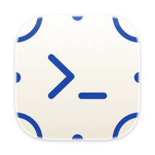
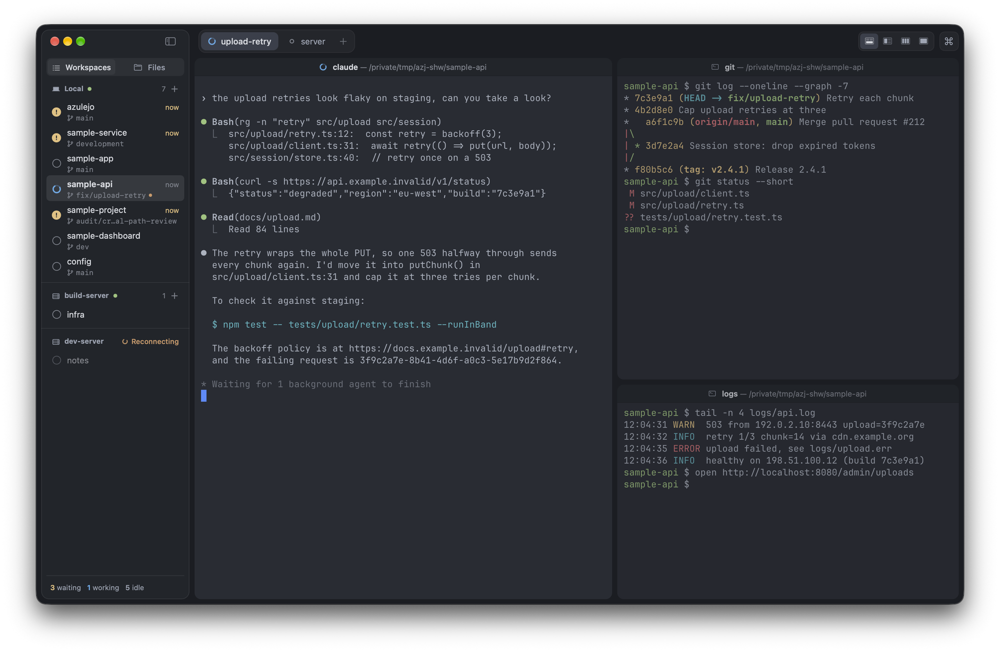

<h1>&nbsp;Azulejo</h1>

<p>A keyboard-driven tiling terminal workspace for macOS.</p>

<p align="center">
  
</p>

Azulejo tiles your terminals in one window and drives them from the keyboard, with a file tree and your agents' status in the sidebar. Its terminals run in [herdr](https://herdr.dev), so your shells and coding agents keep running when you quit the app and come back where you left them. It's for developers who live in the terminal, often with a few agents at work at once, and want a whole project on one screen.

It runs on macOS 14 or later and needs herdr installed. There's no prebuilt download yet: [build it from source](#building-from-source). A GTK4 shell for Linux exists, but it's an early prototype that only draws placeholder tiles.

## Features

- **Dynamic tiling:** Tile, Three Column and Monocle layouts in the style of [Bismuth](https://github.com/Bismuth-Forge/bismuth), or a manual split tree; `alt+hjkl` moves between tiles.
- **Sessions that outlive the app:** herdr keeps every process and its scrollback through a quit and relaunch.
- **Files sidebar (⌘F):** a file tree on the current project; Return opens a file in your editor (`vim` by default) in a split beside the focused tile.
- **Agent status:** working, blocked and finished coding agents show in the sidebar, tab strip, tile headers and Dock badge.
- **Quick open (⌘K):** fuzzy search over every action, workspace, tab and tile.
- **Smart select (⌘S):** pick the URLs, paths, commands or hashes on screen by label, then copy, open or run one.
- **One config file:** rebind any key and pick one of four themes (or write your own); saving applies it, no restart.
- **Scriptable:** the `azj` CLI, a socket API and a Python client; `azj layout apply` opens a project's tabs and tiles from a `.azulejo.toml`.

## Building from source

```sh
mise install        # Rust, Zig, XcodeGen, just, uv at pinned versions
just build          # core crates
just test
just mac            # macOS app → target/macos/Azulejo.app
just linux          # GTK4 shell (Linux only)
```

`just mac` uses XcodeGen and xcodebuild when full Xcode is installed, and falls back to SwiftPM with the Command Line Tools.

### Repository layout

| Path | What |
| --- | --- |
| `core/crates/` | Rust core: `model`, `protocol`, `herdr`, `engine`, `api`, `ffi`, `cli` (`azj`) |
| `apps/macos/` | Swift/AppKit shell; links the core through `ffi`'s C ABI |
| `apps/linux/` | GTK4 shell in Rust; links the core directly |
| `clients/python/` | Python client, generated from the schema |
| `schema/` | Generated JSON Schema for the socket API |

The Linux shell is a workspace member but not a default member, so `cargo build` works on macOS without GTK.

## Docs

- [apps/macos/README.md](apps/macos/README.md): the macOS shell, dev profile, automation
- [docs/keybindings.md](docs/keybindings.md): every default key
- [docs/themes.md](docs/themes.md): themes, terminal colours, `[appearance]`
- [docs/layout-files.md](docs/layout-files.md): open a project's tabs and tiles with one command
- [docs/herdr-notes.md](docs/herdr-notes.md): what herdr does and doesn't do
- [docs/dogfooding.md](docs/dogfooding.md): daily build and setup
- [clients/python/README.md](clients/python/README.md): the Python client

Agent working rules are in [CLAUDE.md](CLAUDE.md).
