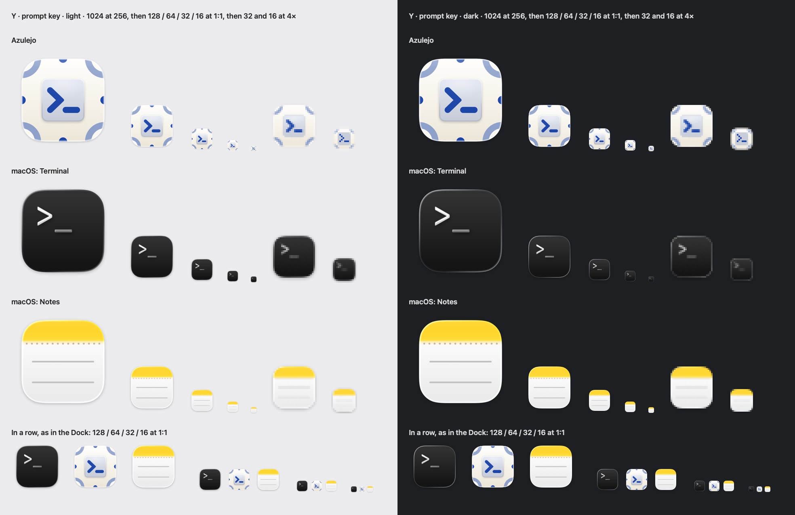
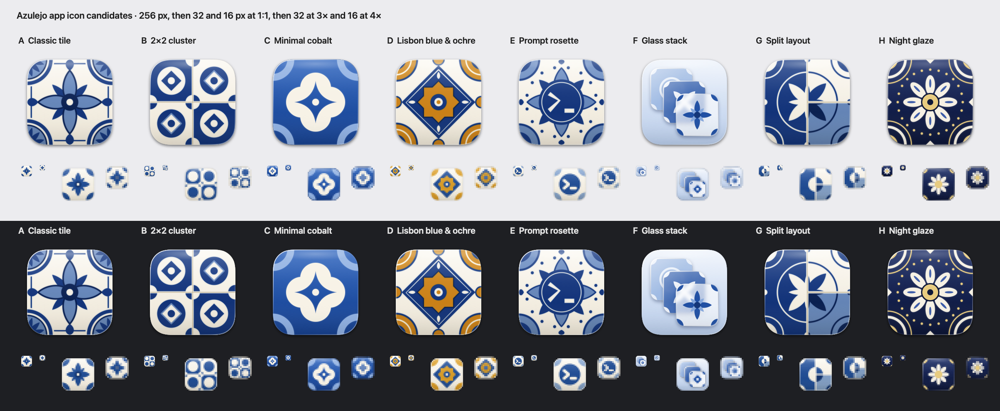
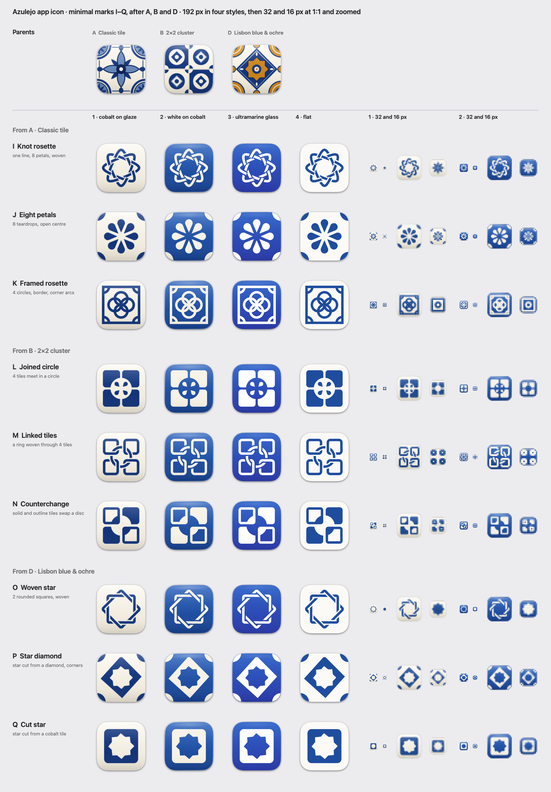
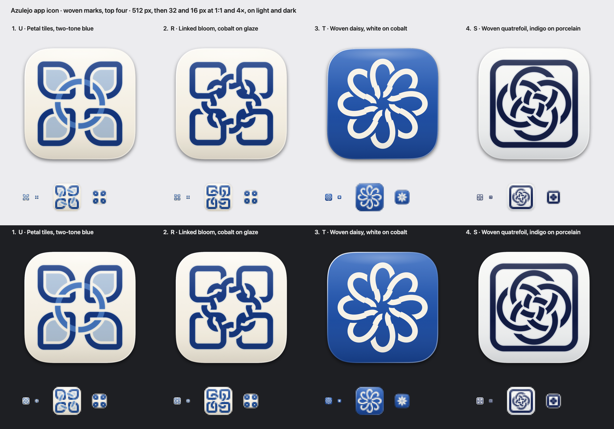
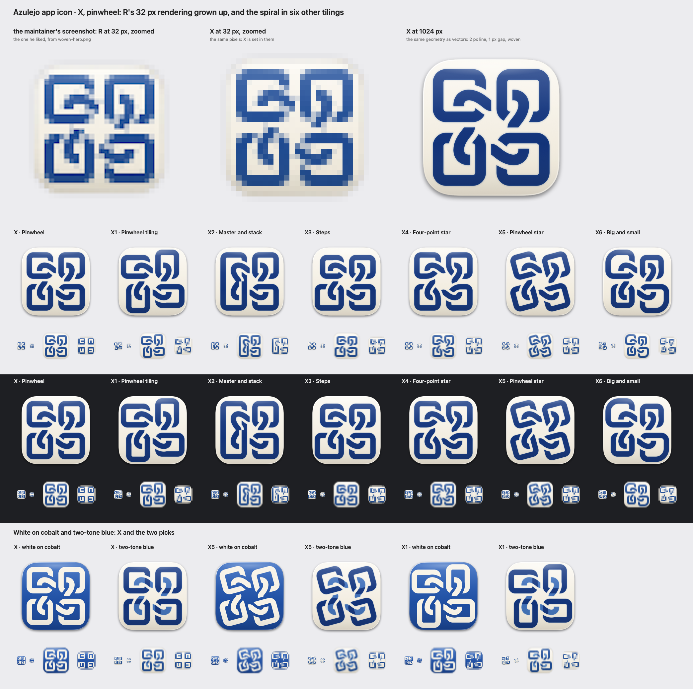

# App icon

**Chosen: X, pinwheel, white on cobalt (Nov 4, 2026).** the maintainer's pick: four tiles linked by one woven spiral says "tiles that complete each other" in a single mark, and white on cobalt stays bold from the Dock down to 16 px.

[`chosen.png`](chosen.png) shows the shipping icon at 1024 (shown at 256), 128, 64, 32 and 16 px, then 32 and 16 blown up 4×, next to Terminal and Notes, on light and dark. Under that the three sit in a row at each size, as in the Dock. The rest of this page is how we got here.

the maintainer's brief (Nov 4, 2026): "a pretty azulejo tile, slightly stylized to match the macOS Liquid Glass aesthetic". Cobalt on a warm tin glaze, a symmetric floral-geometric motif, corner quarter-motifs that would join up with the next tile, and a fine border.

## Candidates

[`options.png`](options.png) puts all eight side by side: 256 px on a light row and a dark row, with the 32 and 16 px renders under each at 1:1 and blown up. [`sheet.png`](sheet.png) is the deeper look at A–C, with the dark and tinted variants and system icons for scale. It stays at A–C because all eight would push it to about 4 MB.

| | File | What it is |
| --- | --- | --- |
| **A · classic tile (default)** | [`candidate-a-classic.png`](candidate-a-classic.png) | One tile: an eight-petal rosette, quarter flowers in the corners, buds at the edge midpoints strung on a fine border |
| B · 2×2 cluster | [`candidate-b-cluster.png`](candidate-b-cluster.png) | Four tiles, cobalt and white alternating like the Alfama pattern in the mockup's browser tile; the joints echo the split layout |
| C · minimal, cobalt glaze | [`candidate-c-minimal.png`](candidate-c-minimal.png) | Inverted: one white quatrefoil with a star on a cobalt glaze, pale quarter rings in the corners |
| D · Lisbon blue & ochre | [`candidate-d-ochre.png`](candidate-d-ochre.png) | Two pigments, like most Lisbon pattern tiles: an ochre eight-pointed star in a cobalt diamond, ochre quarter discs in the corners, ochre half-buds at the edges |
| E · prompt rosette | [`candidate-e-prompt.png`](candidate-e-prompt.png) | A cobalt medallion on an eight-petal flower in a ring of beads, with `>_` left in bare glaze at its heart. Tile first, terminal second |
| F · glass stack | [`candidate-f-glass.png`](candidate-f-glass.png) | Three tiles stacked in depth on a sky glaze, pale blue, cobalt and frosted white. Each pane blurs what's behind it, casts its own shadow and has a rim light |
| G · split layout | [`candidate-g-split.png`](candidate-g-split.png) | One tile cut by grout into the Tile layout, master left and two stacked right. One rosette runs across all three panels and swaps glaze in each |
| H · night glaze | [`candidate-h-night.png`](candidate-h-night.png) | Ink-blue glaze, a white daisy with a gold heart, a ring of gold beads, white and gold quarter rings in the corners. Made for a dark Dock |

**Small sizes, D–H.** D and H are the strongest new ones at 16 px: D keeps its two colours (a yellow star in a blue diamond), H stays a white flower on navy. E reads as a blue disc with `>_` at 32. At 16 the prompt is a hint, and from across the Dock it could pass for a Terminal-style badge. F is stacked panes at 32 and pale on pale at 16. At 32 and below its front tile shows a diamond, not the rosette, which shrank into a "+" button. G is a blue master beside two light panes at both sizes. Its rosette becomes one disc split three ways when small, because the petals read as an "×".

**How to choose.** Set `chosen` in `scripts/icon/draw.swift`, then run `just icon`. A candidate is `let chosen: Icon = .candidate(.night)`; a minimal mark takes a style too, as in `.mark(.knot, .cobalt)` (see "Minimal marks" below). `just icon` rebuilds `AppIcon.icns`, the dark and tinted variants, sheet.png and the stamp `just lint` checks. Commit them together.

**Why A.** It's the one that reads as an azulejo: the kind of tile you'd see on a Lisbon facade, not a pattern that just has the colours. It also holds up small. At 32 and 16 px it drops the border, buds and outlines (see "Small sizes") and stays a blue flower on a white tile. B makes a nice point about tiling, but at 16 px its four tiles blur into a checkerboard. C is the boldest at 16 px, but a blue square with a white blob reads as a generic badge in a row of Dock icons, and it loses the warm glaze. (This was written before D–H existed. A was the default until the maintainer picked X; see the top of this page.)

## Minimal marks (I–Q)

the maintainer's feedback on A–H (Nov 4, 2026): A, B and D are the ones he likes. He wants versions that are more minimal, closer to the OpenAI logo: one confident geometric mark, flat or nearly flat, one even stroke weight, rotational symmetry, interlocking forms, a few repeated primitives. Still an azulejo, and blue.

[`minimal.png`](minimal.png) has A, B and D on top for reference, then nine marks, three after each parent. Each row shows the four styles at 192 px, then styles 1 and 2 at 32 and 16 px, at 1:1 and zoomed.

| | After | What it is |
| --- | --- | --- |
| **I · knot rosette** | A | A's eight petals as one continuous line (a spirograph curve, 8:3), woven over and under itself round an open octagon |
| J · eight petals | A | Eight identical teardrops round an open centre, quarter discs in the corners |
| K · framed rosette | A | Four circles through the centre make the rosette; a square border with quarter arcs in its corners makes it a tile |
| **L · joined circle** | B | Four tiles, each with a quarter circle cut at its inner corner, so a circle opens where they meet, a four-petal rosette inside |
| M · linked tiles | B | A 2×2 of identical rounded squares, one ring woven through all four like a chain |
| N · counterchange | B | B's alternating tiles as two solid and two outline squares; a disc across the joint swaps with them |
| O · woven star | D | D's eight-pointed star as two rounded squares, woven like a khatam |
| **P · star diamond** | D | D in one blue: the star cut from a cobalt diamond, quarter discs in the corners |
| Q · cut star | D | The eight-pointed star cut from a cobalt tile |

Two departures from the brief's suggestions. M is "a ring through four rounded squares", but drawn as outlines so the ring can really weave (over one side of each tile, under the other). Over solid squares the ring had nothing to go under. P was going to be D with a cobalt hub at the star's heart, but the hub made the star a settings cog, so P and Q have none.

**Styles.** Every mark comes in four, from `Style` in `draw.swift`:

1. **Cobalt on glaze**: the warm tin glaze, A's sheen and rim, the cobalt multiplied in with a faint bleed.
2. **White on cobalt**: C's cobalt glaze, a warm white mark.
3. **Ultramarine glass**: cobalt at the top deepening to ultramarine, a white mark, the sheen and rim turned right down.
4. **Flat**: one white, one cobalt. No sheen, rim or bleed; just the squircle, its shadow and a faint hairline.

**Small sizes.** The marks use one stroke weight that grows as the icon shrinks, so a line stays at least a pixel and a half wide and a woven gap at least one pixel. At 16 px there's no room for a gap, so the woven marks and the busiest ones switch to a simpler form:

- **I**: a woven ring at 32 px, a little eight-spoked flower at 16. Solid petals round a hole made a cog, and four petals made an ×.
- **J**: holds as a flower with corners at both sizes, with slimmer petals at 16.
- **K**: at 16 px the four circles merge, so it's a ring in a frame: a tile, not much more.
- **L**: the best of the B family small. At 16 px it's four blue tiles with a round hole where they meet.
- **M**: reworked for small sizes (Nov 4, 2026). It was busy at 32 px, and at 16 a ring cut through four solid tiles read as a target. Now from 64 px down it's set in whole pixels, so the outlines land on the grid. At 32 px the tiles are bigger and bolder (2 px lines, 1 px gaps), and the ring is a little wider so each link reaches further into its tiles. At 16 px it drops the ring and the weave for four bold outlined squares: any ring left there made a target or a ⌘. From 128 px up it's unchanged.
- **N**: four squares with notches; fine, if a little like an app grid.
- **O**: a pinwheel at 32 px; at 16 a solid star, which is an octagon. Weak small.
- **P**: a diamond with a white heart and corner quarters. Strong at both sizes, best in style 2.
- **Q**: a cobalt square with a white star blob. The boldest at 16 px.

Every mark is cleaner at 32 and 16 px than A–H, mostly because one weight and one colour leave nothing to blur.

**Picks** (bold in the table above):

1. **P · star diamond, style 1 (cobalt on glaze).** The one most plainly a tile: D's star and diamond with the corners that meet the next tile, in one blue on the warm glaze. At 16 px it's still a diamond with a white heart.
2. **I · knot rosette, style 2 (white on cobalt).** Closest to the OpenAI brief: one woven line, eight petals, an open centre. At 16 px it's an eight-spoked flower on cobalt.
3. **L · joined circle, style 4 (flat).** The best way to say "tiles that complete each other", the app's whole idea. Bold at 16 px.

To ship one, set `let chosen: Icon = .mark(.diamond, .glaze)` (names: `knot`, `petals`, `framed`, `joined`, `linked`, `counter`, `woven`, `diamond`, `cut`; styles: `glaze`, `cobalt`, `gradient`, `flat`) and run `just icon`. The dark and tinted variants come from the same mark.

## Woven marks (R–W)

the maintainer's feedback on I–Q (Nov 4, 2026): M, linked tiles, in style 1 is the favourite. Before committing he wants versions that are more woven and more flowery, still minimal and OpenAI-like, and to see other colours.

[`woven-hero.png`](woven-hero.png) is the quick look: the top four pairs of mark and palette at 512 px on light and dark, with 32 and 16 px under each. [`woven.png`](woven.png) has every one: M for reference, then six new marks, each in seven palettes at 160 px, with the 32 and 16 px renders of palettes 1 and 3 at 1:1 and zoomed.

| | Grown from | What it is |
| --- | --- | --- |
| **R · linked bloom** | M | M's four tiles. The ring becomes two four-lobed loops woven through each other, one with its lobes in the tiles and one in the joints: an eight-petal garland linked through all four tiles |
| **S · woven quatrefoil** | K | Four circles interlaced over and under, a Celtic or Islamic quatrefoil, inside one rounded tile outline |
| **T · woven daisy** | I | Eight petal loops round an open centre, each woven through the next |
| **U · petal tiles** | M | M with each tile drawn as a petal (tight corners on its diagonal, full ones either side), the ring woven through all four. The tiles are the flower |
| V · flower of four tiles | L, M | L's four tiles with a circle bitten out where they meet. R's flower sits in it, and each tile holds a quarter: the lobes on the diagonals reach through the bite and weave with their tile |
| W · woven star-flower | O | O's two woven squares as two four-lobed loops: an eight-pointed star whose points are round petals |

Departures from the brief's suggestions:

- **R** was going to be four petal loops, one per joint. Petals in the joints run along the tile edges instead of crossing them, and petals on the diagonals hooked through the tiles like fish hooks. Two four-lobed loops give the eight petals and keep every crossing clean.
- **T** was going to be a rosette from two squares and two circles on a 2×2 grid. That came to more than 24 crossings, which is a doily, not a mark. The woven daisy keeps the eight petals and drops the grid.
- **U** was going to be tile outlines that weave into each other with no ring. Four rounded squares can't overlap their neighbours without all four piling up in the middle at this line weight. So the tiles became petals and kept M's ring.

**Palettes.** Seven, each a `Style` in `draw.swift`, so any mark (I–W) takes any of them:

1. **Cobalt on glaze** (`glaze`): the maintainer's current favourite. The warm tin glaze, cobalt multiplied in with a faint bleed.
2. **Indigo on porcelain** (`indigo`): a darker, inkier navy on a cooler white.
3. **White on cobalt** (`cobalt`).
4. **Sky glass** (`sky`): ultramarine at the foot lifting to sky blue at the top, a white mark, a subtle sheen.
5. **Manganese on glaze** (`manganese`): aubergine, the purple-brown of 16th- and 17th-century Portuguese tiles.
6. **Verdigris on glaze** (`verdigris`): the green-blue of older tiles.
7. **Two-tone blue** (`twoTone`): cobalt, with the floral strands in a lighter sky blue and the petals washed paler still. Each mark has `main` strands (tiles, frames) and `second` ones (the flower), and some have a `fill`. The wash stays a gap clear of every line, so it never touches one.

I–Q's `gradient` (ultramarine glass) and `flat` still work too. All of them keep the macOS 26 squircle, shadow, sheen and rim rules; only the colours and the sheen's strength change.

**Small sizes.** Each mark has its own 32 and 16 px form. Where it's tiled, it's set in whole pixels like M.

- **R**: at 32 px, sixteen crossings are mush, so it's M's 32 px tiles with one four-lobed loop. That reads as M, plainly. At 16 px it's M's four bold outlined tiles. R is M once it's small.
- **S**: at 32 px the frame stays at 2 px and the circles thin to 1.5 px with a 1 px gap. The knot shows, just. At 16 px it's a solid four-lobed clover in a frame, which holds up well.
- **T**: at 32 px the line thins to 1.5 px so all sixteen crossings still show, and it's clearly a daisy. At 16 px it's eight solid petals from the centre, I's little flower. Petals round an open centre made a cog.
- **U**: at 32 px it's M's grid with petal corners and the ring woven through, crisp. At 16 px it's M's four outlined tiles, since the petal corners are a pixel at most there.
- **V**: the weakest small. At 32 px any loop through the bites tangles, so the flower comes loose: four small solid petals in the circle. At 16 px it's L at 16, four solid tiles round a hole.
- **W**: a pinwheel at 32 px. At 16 px it's a solid eight-petal flower with no hole (with a hole it was a cog), which reads more as a seal than a flower. Weak at 16.

**Picks** (bold in the table above):

1. **U · petal tiles, two-tone blue.** M, which the maintainer already likes, made into a flower: the tiles are petals, the ring still links them, and the pale wash in each petal gives depth without another shape. At 32 and 16 px it's as crisp as M, because it is M there.
2. **R · linked bloom, cobalt on glaze.** The most woven M: a garland of eight petals through all four tiles. Busier at 512 than U. Small, it falls back to M.
3. **T · woven daisy, white on cobalt.** The most flowery and the most OpenAI-like: one primitive, eight times, every crossing woven. It's the only pick that stays a flower at 16 px. Less obviously a tile.
4. **S · woven quatrefoil, indigo on porcelain.** The most traditional interlace, framed as a tile. The ink-dark navy suits its Celtic weight. A clover in a frame at 16 px.

W in two-tone (a pale heart inside the woven star) and V in any palette are worth a look in woven.png too.

**How to choose.** Set `chosen` in `scripts/icon/draw.swift` to a mark and a palette, then run `just icon`. For example, `let chosen: Icon = .mark(.petalTiles, .twoTone)`. Marks: `bloom`, `quatrefoil`, `daisy`, `petalTiles`, `fourTiles`, `starFlower` (plus I–Q's `knot` … `cut`). Palettes: `glaze`, `indigo`, `cobalt`, `sky`, `manganese`, `verdigris`, `twoTone` (plus `gradient`, `flat`). `swift scripts/icon/draw.swift --woven DIR` writes just the two woven sheets.

**The weave.** I, M, O and R–X are closed strands drawn at one weight, each strand in its own colour if it likes. `weave()` finds every place they cross, themselves included, and picks over or under so each strand alternates as it goes. Then it cuts a gap either side of the strand on top, only along the two passages at that crossing. Nothing is hand-placed, so a mark can change shape and stay woven.

## Pinwheel (X)

the maintainer's feedback on R–W (Nov 4, 2026): the one he likes is a 32 px rendering in woven-hero.png ([`pinwheel-liked-32px.png`](pinwheel-liked-32px.png)). That's **R, linked bloom, cobalt on glaze, at 32 px**, not U: U's 32 px has a sky-blue ring and pale petals, and this is one cobalt. Four chunky outlined tiles and one four-lobed loop, woven, so each lobe reads as a hook and the four hooks as a pinwheel. He likes that simplified form, not the full-size R.

**X** is that 32 px rendering grown up. Its geometry is set in pixels of a 32 px icon at every size: tiles 1 to 11 px out from the centre, a 2 px line, 1.5 px corners, the loop `lobes(6 px, 0.32)` and a 1 px gap where strands cross. At 1024 that's a 64 px line and a 32 px gap, as smooth vectors with true over and under. X's own 32 px render matches R's pixel for pixel. At 16 px every line moves out to a pixel's centre, so the tiles stay crisp at 1 px. X's 1 px spiral couldn't: its curves smeared into grey and its weave gaps broke the tiles. So from Nov 4, 2026, X at 16 px keeps its tiles whole and swaps each hook for a 2 × 1 px tongue, from the tile's centre to the side the hook comes in by at 32 px. The four tiles read as C, n, Ↄ, U, turning clockwise like the hooks. X1–X6 still draw the spiral at 16 px.

X1–X6 keep the spiral exactly, the same loop with the same over and under, and change the tiles round it. The loop is passed to `weave()` first, so it sets the over and under and the hooks turn the same way in every variant.

| | What it is |
| --- | --- |
| **X · pinwheel** | R at 32 px, grown up: four 8 × 8 tiles, four hooks |
| **X1 · pinwheel tiling** | Four 7 × 9 rectangles, each running on past the next one's end, so the outline turns like a windmill round the spiral |
| X2 · master and stack | One tall tile holding two lobes, two tiles stacked beside it, like the app's default layout |
| X3 · steps | Each tile's inner corner stays put while the tiles grow clockwise from top left: 7 × 7, 8 × 7, 8 × 8, 9 × 8 |
| X4 · four-point star | Inner corners rounded wide, so the joints open into a four-point star at the centre, the hooks curling round it |
| **X5 · pinwheel star** | Each tile turned 15° anticlockwise: the joints become blades and the gap a four-point pinwheel star |
| X6 · big and small | Two 9 × 9 tiles on one diagonal and two 7 × 7 on the other, the big ones' outer corners rounded to sit in the icon's |

[`pinwheel.png`](pinwheel.png) has the screenshot, X's 32 px and X at 1024 side by side at the top. Under them every X is at 256 px with 32 and 16 px at 1:1 and zoomed, on light and dark. At the bottom are X, X5 and X1 in white on cobalt and two-tone blue (the loop in sky blue).

Departures from the brief's suggestions:

- **The spiral is the same size in every variant**, so the tiles can't change much. Each tile has to hold a lobe that reaches 7 px out, and the icon ends 12.9 px out. The sizes vary between 7 and 9 px, and X1 and X6 run their long sides out to 12 px.
- **X1** isn't four rectangles round a central square tile. Any edge near the spiral's waist, 4 px out on the axes, runs alongside the loop and leaves slivers. So the windmill turns in the tiles' outer ends, and the open centre is the square.
- **X2** has one tall tile and two stacked, not three. A third tile's joint would run through a lobe.
- **An eight-point star gap didn't work.** Its four diagonal points poke into the tiles right where the lobes are. Notched corners left the loop running alongside the notch, a mess of short cut ends. Tiles set on point (diamonds) put a crossing on every corner. So X4 and X5 are the two star gaps: a four-point star and a four-point pinwheel star.
- **X5** turns anticlockwise. Turned clockwise, the loop crosses each tile at a corner and slices it into a flame.

**Small sizes.** At 32 px every X is set in the same pixels as X, so the hooks read in all of them. X5 shows its turn at 32 px. At 16 px the turn moves a corner by less than a pixel and blurs every line, so X5's tiles stay square there. At 16 px, X2, X3 and X4 read best as tiles plus a spiral. X1 and X6 read a little looser, because their long sides crowd the edge.

**Picks:**

1. **X5 · pinwheel star.** The most movement: the tiles turn with the hooks, and the gap is a little turbine. Strong in white on cobalt. At 16 px it's X.
2. **X1 · pinwheel tiling.** The windmill outline says "tiling" before you see the hooks. It's the closest to an actual tiling-window layout, and it reads well in two-tone.

X itself is the safe one: exactly what the maintainer picked, made crisp.

**How to choose.** Set `chosen` in `scripts/icon/draw.swift` and run `just icon`, for example `let chosen: Icon = .mark(.pinwheelStar, .glaze)`. Marks: `pinwheel` (X), `pinwheelTiling`, `masterStack`, `steps`, `astroid`, `pinwheelStar`, `bigSmall` (X1–X6). Any palette works, and `twoTone` draws the loop in sky blue. `swift scripts/icon/draw.swift --pinwheel docs/design/icon` writes just pinwheel.png.

## Liquid Glass, baked in

Without Xcode there's no `actool`, so the icon ships as a flat `AppIcon.icns`. The glass is drawn into it, following Apple's macOS icon template:

- **Shape and grid.** A 1024 px canvas, with an 824 × 824 rounded square centred in it (100 px margin). The corners are Apple's continuous curve (radius 185.4, the same Béziers UIKit uses), not a plain rounded rect. Everything inside is fully opaque.
- **Shadow.** The template's drop shadow: black at 50 %, blur 28, 12 px down. It's halved at 32 px and below, where it would only smudge.
- **Glaze.** A warm white gradient. The blue is multiplied into it over a faint blurred copy of itself, so the cobalt seems to sit in the glaze, not on it.
- **Glass.** A sheen over the top half, a soft specular bloom under the top edge, and a rim light that's brightest top-left and catches again bottom-right. A faint hairline inside the edge keeps a white tile's shape on a white background.

**Small sizes.** Each size is drawn at its own pixel size, not scaled down from 1024. From 128 px up you get every detail. At 64 px the corner petals and the ink bleed go and the lines get thicker. At 32 and 16 px the border, the buds and the petal outlines go too, and the rosette turns solid cobalt.

**macOS 26 doesn't jail it.** Tahoe shrinks icons that don't fill its squircle onto a grey plate. [`tahoe-check.png`](tahoe-check.png) shows what IconServices (`NSWorkspace.icon(forFile:)`) made of three bundles on Nov 4, 2026, on macOS 26. Left: the built `target/macos/Azulejo.app`, full size in the system squircle. Middle: a control bundle whose icon is a plain circle, shrunk onto the grey plate. Right: Terminal, for scale. (The control's ⃠ badge only means that bundle had no executable.) `CFBundleIconName` without an `Assets.car` falls back to `CFBundleIconFile` cleanly.

## Variants

- [`appearance-dark.png`](appearance-dark.png): a night glaze with the blue lifted, for the dark icon style.
- [`appearance-tinted.png`](appearance-tinted.png): a monochrome source of the kind macOS colours for the tinted style.

An `.icns` holds one appearance, so neither ships yet. macOS 26 derives its own dark and tinted versions of a flat icon.

## What Xcode would add

Icon Composer (with Xcode 26) saves a layered `.icon` document. `actool` compiles it into `Contents/Resources/Assets.car` under the name in `CFBundleIconName` (already `AppIcon`). Layered, the system draws the glass live: specular highlights that follow the light, refraction, translucency, and our own default, dark, clear and tinted appearances instead of derived ones. There's no supported way to write `Assets.car` without `actool`, and the Command Line Tools don't include it. The way in later:

1. Export the motif from `draw.swift` as layers: the glaze background as a gradient, the cobalt motif as a foreground layer without the baked sheen, rim or shadow. Build `AppIcon.icon` in Icon Composer and set the dark and tinted colours from the variants above.
2. In `bundle.sh` and `scripts/release/build-mac.sh`, when `xcrun --find actool` succeeds, compile it into `Contents/Resources` (along the lines of `xcrun actool AppIcon.icon --compile <Resources> --app-icon AppIcon --platform macosx --minimum-deployment-target 14.0 --output-partial-info-plist …`; check the flags against the Xcode you have). Keep `AppIcon.icns` as the fallback for macOS 14 and 15 and for machines without Xcode.

## Files and commands

- `scripts/icon/draw.swift`: the source. Pure CoreGraphics, plus CoreImage's software renderer for the blur, so output is byte-identical from run to run on the same macOS. `swift scripts/icon/draw.swift --minimal DIR` writes just minimal.png, `--woven DIR` just woven.png and woven-hero.png, `--pinwheel DIR` just pinwheel.png, and `--chosen DIR` just chosen.png.
- `just icon` (`scripts/icon/build.sh`): renders the iconset (16–512 at @1x and @2x) and packs `apps/macos/Resources/AppIcon.icns` with `/usr/bin/iconutil`. It also writes these PNGs (minimal.png, the woven sheets, pinwheel.png and chosen.png included) and `scripts/icon/AppIcon.sha256`.
- `just lint` runs `scripts/icon/build.sh --check`. It fails when `draw.swift` or the `.icns` changed without a `just icon`. It compares hashes and doesn't re-render, so a different macOS version's antialiasing can't trip it.
- `apps/macos/bundle.sh` (`just mac`) and `scripts/release/build-mac.sh` (`just release-mac`, `just dogfood`) copy the `.icns` into `Contents/Resources`. `Info.plist` sets `CFBundleIconFile` and `CFBundleIconName` to `AppIcon`.
